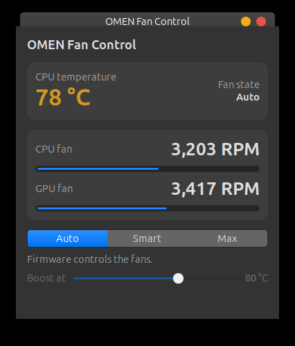

# OMEN Fan Control

A small GTK app for switching HP OMEN laptop fans between **Auto**, **Smart** and **Max** on Linux.



| Mode | What it does |
|---|---|
| **Auto** | The firmware controls the fans. |
| **Smart** | Switches to Max once the CPU reaches the temperature you pick (55–95 °C), and back to Auto when it cools 8 °C below that. |
| **Max** | Both fans at full speed. |

It shows CPU temperature and both fan speeds, updated every 1.5 s. Closing the window puts the fans back to Auto, so they never stay stuck at full speed. Your last mode and threshold are saved in `~/.config/omen-fan/config.json`.

## Why no percentage slider?

The Linux `hp-wmi` driver only exposes `pwm1_enable` for these laptops, and it accepts just two values: `0` (max) and `2` (auto). Anything else is rejected with `Invalid argument`. Smart mode is a temperature-triggered boost built on top of those two states.

## Requirements

- An HP OMEN or Victus laptop where the `hp_wmi` module provides a hwmon device named `hp` with `pwm1_enable`. Check with:
  ```sh
  grep -l '^hp$' /sys/class/hwmon/hwmon*/name
  ```
- Python 3.10+ with GTK 3 bindings (`python3-gi`, preinstalled on Ubuntu/GNOME).

Tested on an OMEN Slim 16t-an000 (board 8D40), Ubuntu 24.04, kernel 6.14.

## Install

```sh
git clone https://github.com/iam-shanmukha/omen-fan-control.git
cd omen-fan-control
./install.sh
```

`install.sh` adds the udev rule `/etc/udev/rules.d/99-omen-fan.rules`, which lets members of the `sudo` group change the fan mode without a password prompt. It also adds an "OMEN Fan Control" entry to your app menu.

Run it from the app menu, or with:

```sh
python3 omen_fan_gui.py
```

## Uninstall

```sh
sudo rm /etc/udev/rules.d/99-omen-fan.rules
rm ~/.local/share/applications/omen-fan.desktop ~/.config/omen-fan -r
```

## Tests

```sh
python3 -m pytest
```

## License

MIT
